<p align="center">
  
</p>

<h1 align="center">Steam Artwork for Non-Steam Games</h1>

<p align="center"><b>Proper Steam library artwork for every game you added yourself. Still or animated, in one click.</b></p>

<p align="center">
  <a href="https://github.com/acidtwin/SteamArtworkForNonSteamGames/releases"></a>
  <a href="https://github.com/acidtwin/SteamArtworkForNonSteamGames/actions/workflows/tests.yml"></a>
  <a href="LICENSE"></a>
  <br>
  
  
  
  
  <a href="https://github.com/acidtwin/SteamArtworkForNonSteamGames/releases/latest/download/SteamArtworkForNonSteamGames.flatpak"></a>
  <a href="https://github.com/acidtwin/SteamArtworkForNonSteamGames/releases/latest/download/SteamArtworkForNonSteamGames-Windows.zip"></a>
  
</p>

A small desktop app that gives your **non-Steam games** proper artwork in Steam. It finds Steam on its own, lists every non-Steam shortcut you've added, and pulls all five artwork types from [SteamGridDB](https://www.steamgriddb.com), or Steam's own store art when the game is sold there, in one click. Still or animated. You can then swap any piece you don't like from a visual picker.

I wanted an intuitive, easy-to-use and visually pleasing alternative for giving non-Steam games their artwork, so I built one.

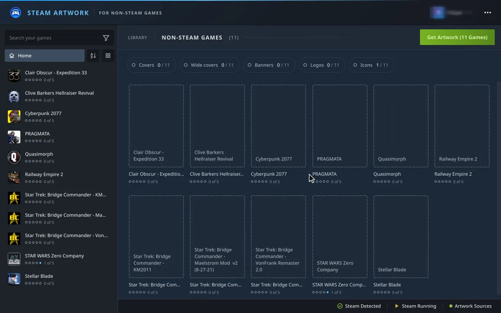

Linux first, including Steam Deck desktop mode: the window fits the Deck's 1280×800 screen. Also on Windows, as a portable app.

<sub>Pictures from a real library (the Steam login name is blurred). Artwork by the SteamGridDB community and the games' publishers.</sub>

## Features

### Your library as a cover wall

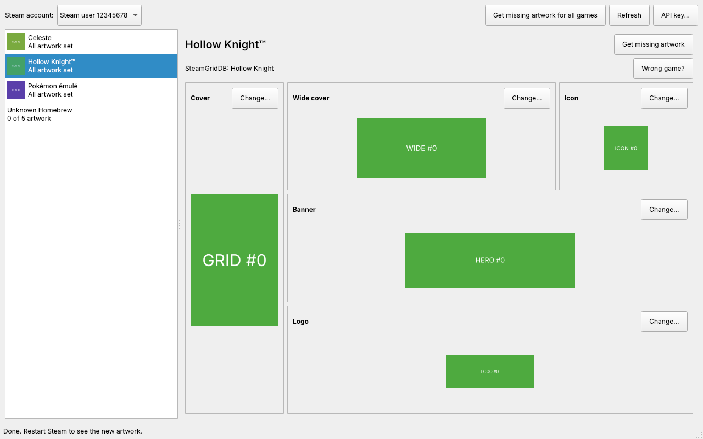

The start page looks like your Steam library. Games without a cover show as dashed tiles, so the gaps stand out, and the counts along the top say how many games have each piece. Switch between **Grid**, **List** and **Details** views, sort **A to Z**, **Z to A**, **Missing artwork first** or **Recently added**, and narrow the list to **Missing Artwork** or **Needs a Look**. The search box filters the wall too.

<p>
  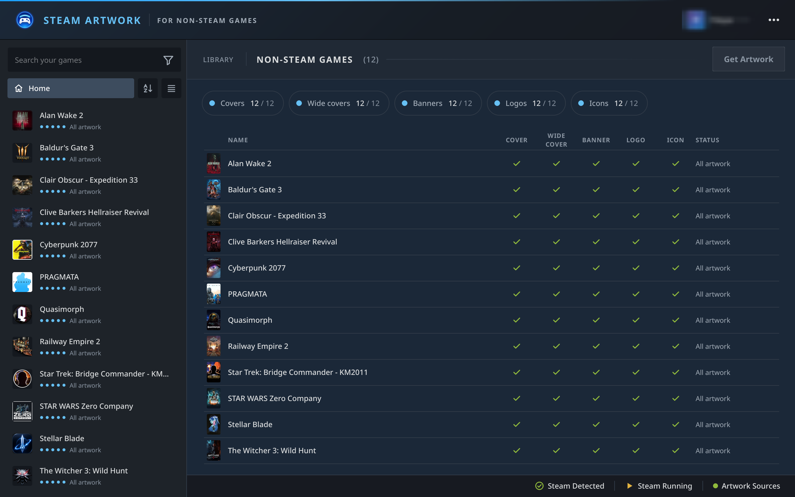
  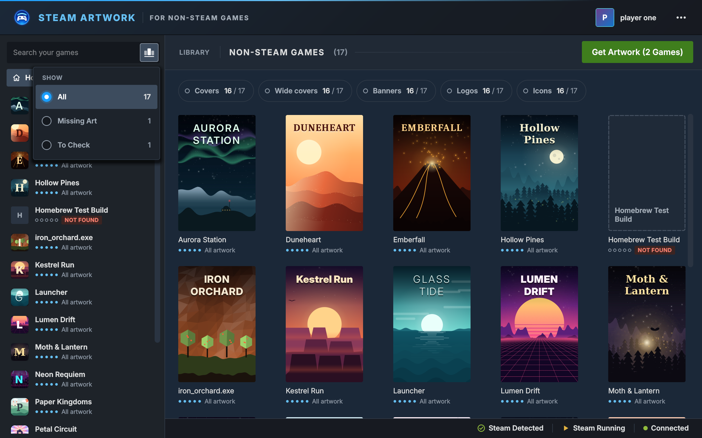
</p>

### All five pieces, each with its options beside it

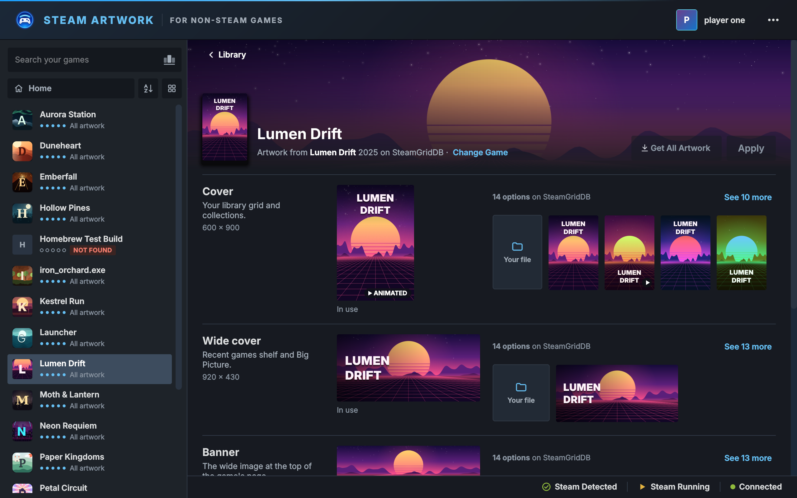

**Cover, Wide cover, Banner, Logo and Icon** each get a row that says where Steam shows it and what size it is, with the art in use and a strip of options next to it. Hover an option to preview it in place, click to pick it. Pictures shimmer while they load, retry by themselves if the connection drops, and say so if they still can't load.

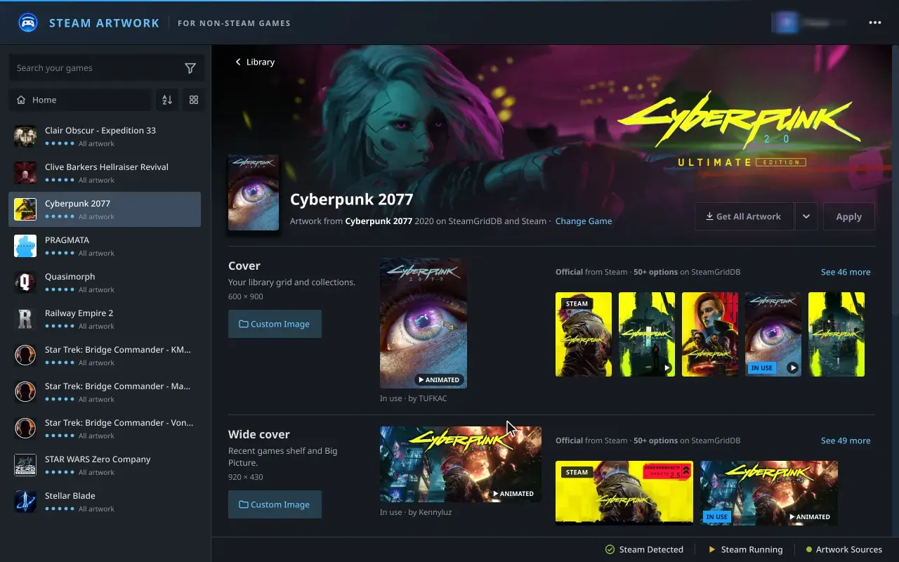

**See more** opens a panel with every option for that piece, four covers wide, animated ones playing at full size. Filter by style, hover to see an option on the page behind, click to pick it.

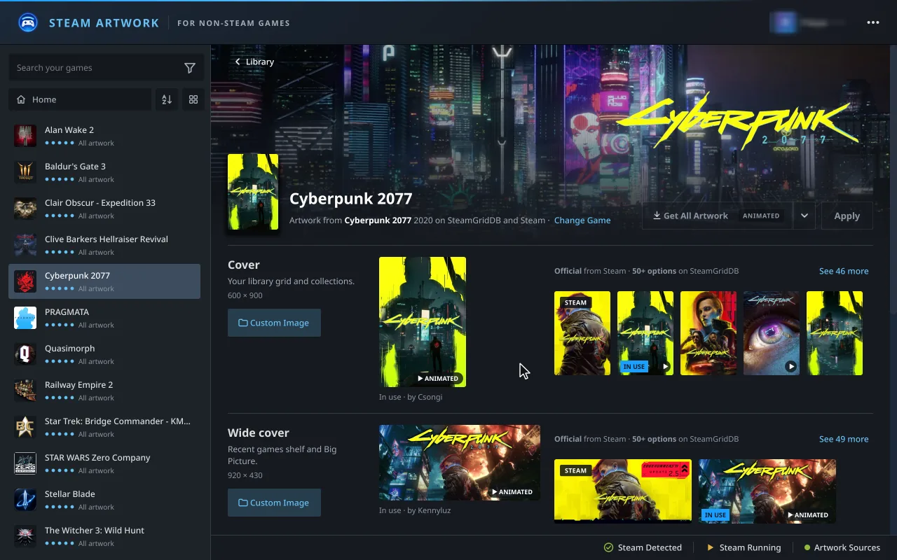

### Animated artwork

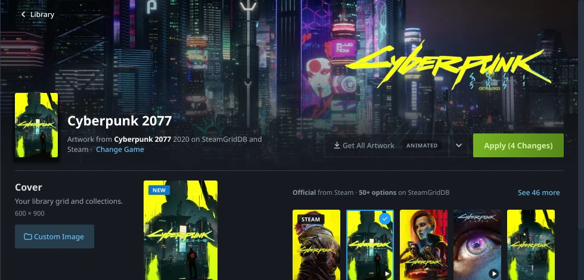

Animated covers, wide covers, banners and logos sit in the same strips as still ones, marked with a small play tag, and play in the app and in your Steam library. The game page plays them too, with the logo over the banner as Steam shows it. Turn them off with **Show Animated Artwork** in the ⋯ menu. Icons stay still, as Steam doesn't animate them.

### Steam's own artwork

If the game is also sold on Steam, its official store art comes first in each row, tagged **STEAM**, and Get All Artwork uses it before anything else. It works without a SteamGridDB key, and **Change Game** picks a different Steam game if the name matched the wrong one. Turn it off with **Use Steam's Official Artwork** in the ⋯ menu. The pictures are fetched from the store on your computer when you ask for them; none are shipped with the app.

### Your own pictures

Every row has a **Custom Image** button. Click it to choose a picture, paste one with Ctrl+V, or drop one on the row. On Apply the picture is copied into Steam's artwork folder under the name Steam expects, and your original is left alone.

If neither SteamGridDB nor Steam has an icon for a game, the icon inside the game's own .exe is used.

### Proper names for games called "Launcher"

Shortcuts often end up with titles like `Launcher` or `game.exe`. The app looks those up by the folder the game sits in, and offers to rename them to the game they turned out to be. Get Artwork and Apply take the new title along by default, and the game keeps its artwork links when it's renamed.

### One click for everything

**Get Artwork** matches every shortcut on SteamGridDB and fills whatever it's missing with the top-rated option. It never replaces artwork you already have. A game matched by a best guess is tagged **Check match**, and **Change Game** lets you search SteamGridDB yourself. Your choice is remembered.

On a game's page, **Get All Artwork** does the same for one game. The arrow beside it chooses whether it takes **Still** or **Animated** artwork, and the button says **Animated** when that's on. The same choice is **Get All Prefers Animated Artwork** in the ⋯ menu, and Get Artwork on the library page follows it too.

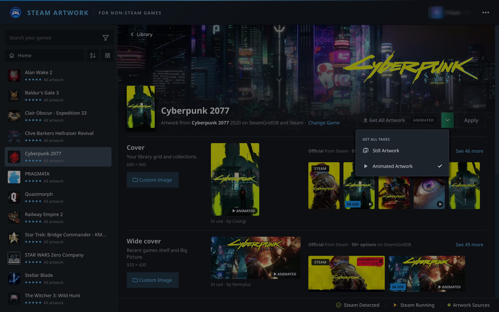

### Nothing changes until you press Apply

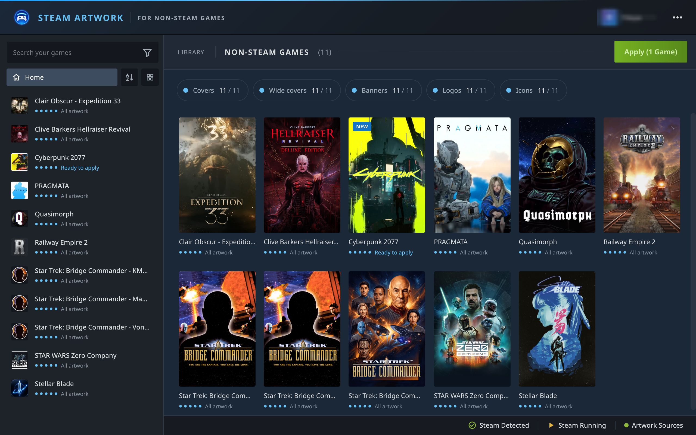

Picks wait as **Ready to apply** until you press **Apply**, so you can try things without touching Steam. Apply backs up Steam's game list first, writes everything in one go, and offers **Undo** straight after.

Steam only shows new artwork after a restart, so Apply can restart Steam for you. Choose that, and whether to apply when you quit, from the Steam pop-over in the status bar.

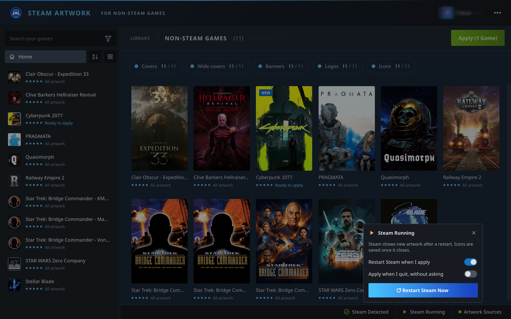

### Finds Steam on its own

Native, Flatpak and Snap installs on Linux (`~/.local/share/Steam`, `~/.steam/steam`, `~/.var/app/com.valvesoftware.Steam/...`, `~/snap/steam/...`) and the registry path on Windows. It picks the account you last signed in with, and lets you switch if there's more than one. If Steam lives somewhere else, **Steam Folder…** in the ⋯ menu searches for it or lets you choose it.

## Install

Version 1.1.0.

### Flatpak (recommended)

Download [**SteamArtworkForNonSteamGames.flatpak**](https://github.com/acidtwin/SteamArtworkForNonSteamGames/releases/latest/download/SteamArtworkForNonSteamGames.flatpak) (12 MB) from the latest release, then install it:

```bash
flatpak install --user ./SteamArtworkForNonSteamGames.flatpak
flatpak run io.github.acidtwin.SteamArtworkForNonSteamGames
```

Many software centres (KDE Discover, GNOME Software) also install it if you open the file. The KDE runtime it needs comes from Flathub, so the Flathub remote should be set up ([setup guide](https://flathub.org/setup)). On a Steam Deck, do this in desktop mode.

To build the Flatpak yourself, use the manifest in [`packaging/flatpak/`](packaging/flatpak/).

### Windows (portable)

Download [**SteamArtworkForNonSteamGames-Windows.zip**](https://github.com/acidtwin/SteamArtworkForNonSteamGames/releases/latest/download/SteamArtworkForNonSteamGames-Windows.zip) from the latest release, unzip it anywhere, and run `SteamArtworkForNonSteamGames.exe` from the folder. There's nothing to install.

The app isn't signed, so the first time you run it Windows SmartScreen may say it "protected your PC": click **More info**, then **Run anyway**. The build is made by [GitHub Actions](.github/workflows/windows.yml) from this repository.

### From source

You need Python 3.10 or newer.

```bash
git clone https://github.com/acidtwin/SteamArtworkForNonSteamGames.git
cd SteamArtworkForNonSteamGames
python3 -m venv .venv
source .venv/bin/activate        # Windows: .venv\Scripts\activate
pip install .
steam-artwork-finder
```

To add it to your app menu on Linux, install the launcher and its icon:

```bash
install -Dm644 packaging/io.github.acidtwin.SteamArtworkForNonSteamGames.desktop ~/.local/share/applications/io.github.acidtwin.SteamArtworkForNonSteamGames.desktop
install -Dm644 packaging/io.github.acidtwin.SteamArtworkForNonSteamGames.svg ~/.local/share/icons/hicolor/scalable/apps/io.github.acidtwin.SteamArtworkForNonSteamGames.svg
```

To run straight from the source folder without installing:

```bash
pip install -r requirements.txt
python3 -m steam_artwork_finder
```

## How to use it

1. **Get a SteamGridDB API key.** Sign in at [steamgriddb.com](https://www.steamgriddb.com), go to **Preferences → API** ([direct link](https://www.steamgriddb.com/profile/preferences/api)) and copy your key. It's free. The app asks for it the first time you open it and checks it before saving.
2. **Press Get Artwork** to fill every gap at once, or pick a game on the left and choose pieces yourself.
3. **Check anything tagged Check match**, and use **Change Game** if the app picked the wrong one.
4. **Press Apply.** Steam restarts to show the new artwork, unless you've turned that off.

Changed your mind? **Undo** appears right after Apply, and **⋯ → Restore Steam's Game List…** brings back any earlier backup.

## Where things are saved

| Artwork    | File in `Steam/userdata/<your id>/config/grid/` |
|------------|-------------------------------------------------|
| Cover      | `<appid>p.png` (or `.jpg`)                      |
| Wide cover | `<appid>.png`                                   |
| Banner     | `<appid>_hero.png`                              |
| Logo       | `<appid>_logo.png`                              |
| Icon       | `<appid>_icon.png`, linked from the shortcut's `icon` field in `shortcuts.vdf` |

`<appid>` is the shortcut's id from `shortcuts.vdf`. For very old shortcuts that don't store one, it's worked out the same way Steam does it. Animated artwork keeps the same names: Steam reads the file's contents, not its ending.

Icons are linked from inside `shortcuts.vdf`, which Steam rewrites when it exits. So while Steam is running the app saves the icon file and links it as soon as Steam closes (or the next time the app starts).

The app's own settings (your API key and remembered game matches) live in `~/.config/steam-artwork-finder/config.json` on Linux or `%APPDATA%\steam-artwork-finder\config.json` on Windows. The file is readable only by you. Thumbnails are cached in `~/.cache/steam-artwork-finder`.

## How it keeps your shortcuts safe

- Before the first change in a session, `shortcuts.vdf` is copied to `config/shortcuts-backups/shortcuts-<date>-<time>.vdf`. The last 10 backups are kept.
- If Steam rewrote `shortcuts.vdf` while the app was open (it does so every time it exits), the app notices before writing, re-reads the newer list and redoes only its own change on top of it. It never overwrites a list it hasn't read.
- The new file is written to a temporary file, flushed to disk and then swapped into place, so a crash or power cut can't leave a half-written file.
- Before writing, the app re-parses its own output and refuses to save if the number of shortcuts would change. After writing, it reads the file back to check it matches.
- The binary VDF reader keeps every value's original type, so loading and saving an untouched file gives back exactly the same bytes. Unusual text encodings written by other tools are preserved too.
- Artwork you replace isn't deleted. It's moved to `grid/.replaced/` and kept for 30 days.

To restore a backup, use **⋯ → Restore Steam's Game List…**. The list you had before is backed up too, so a restore can itself be undone.

## Keyboard

Arrow keys move through the game list, Tab reaches every piece and option, Enter opens or applies, Esc closes the See all panel and menus. Ctrl+F jumps to the search box, Ctrl+V pastes a picture into a row, Ctrl+Z undoes the last change while its message is showing, and F5 or Ctrl+R re-reads Steam's game list.

## Development

```bash
pip install -e ".[dev]"
pytest
```

The tests build synthetic `shortcuts.vdf` files, so they don't need Steam installed or a SteamGridDB key.

| Path | What it does |
|------|--------------|
| `steam_artwork_finder/steam.py` | Finds Steam installs, users and whether Steam is running |
| `steam_artwork_finder/binvdf.py` | Lossless binary VDF reader and writer |
| `steam_artwork_finder/shortcuts.py` | Shortcut list, app ids, backups and safe saving |
| `steam_artwork_finder/sgdb.py` | SteamGridDB API v2 client |
| `steam_artwork_finder/steamstore.py` | Steam store search and official artwork |
| `steam_artwork_finder/exeicon.py` | Icons read from a game's .exe |
| `steam_artwork_finder/artwork.py` | Artwork types, file names and saving |
| `steam_artwork_finder/pending.py` | Picks waiting for Apply |
| `steam_artwork_finder/gui/` | The Qt (PySide6) window: `library.py` (game list, cover wall), `gamepage.py` (artwork rows), `tray.py` (the See all panel), `motion.py` (animated artwork), `workers.py` (downloads and retries), `theme.py` (colours from DESIGN.md) |
| `docs/render/` | Makes the README pictures: runs the app offscreen against made-up games, or a copy of your own library (`REAL=1`) |
| `packaging/` | Desktop entry, icon and AppStream metainfo for Linux; `windows/` has the PyInstaller build for Windows |

## Roadmap

- Publish on Flathub (once the app has more history), PyPI and the AUR (the Flatpak needs read/write access to `~/.local/share/Steam`, `~/.steam` and `~/.var/app/com.valvesoftware.Steam`, and `--talk-name=org.freedesktop.Flatpak` to tell whether Steam is running from inside the sandbox)
- Touch-friendly menus and previews for Steam Deck

## Credits

Made by [Acid Design](https://aciddesign.uk), who owns the project, designed it, directed the build and tested it. Built with the help of [Claude Code](https://claude.com/claude-code), which wrote the code to that direction.

Artwork comes from [SteamGridDB](https://www.steamgriddb.com) and its community of artists. This project isn't affiliated with Valve or SteamGridDB.

## Licence

MIT. See [LICENSE](LICENSE).
